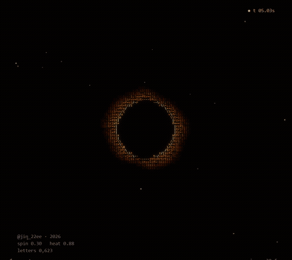
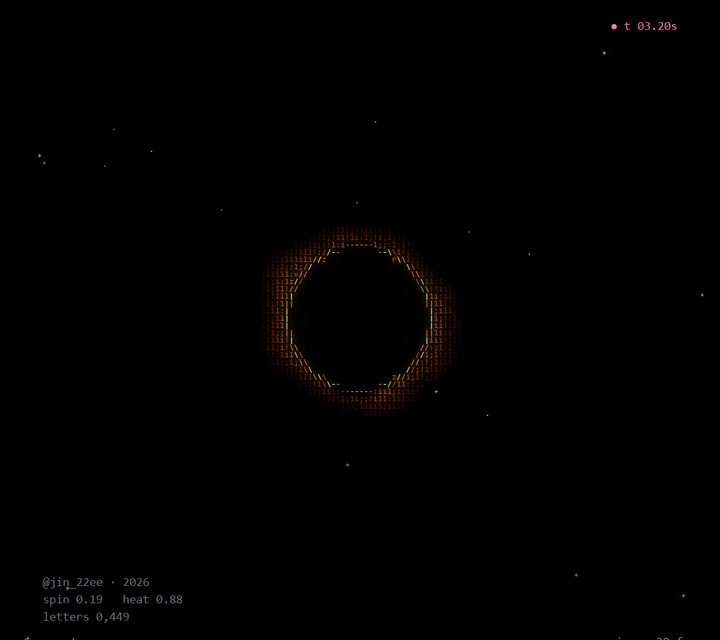
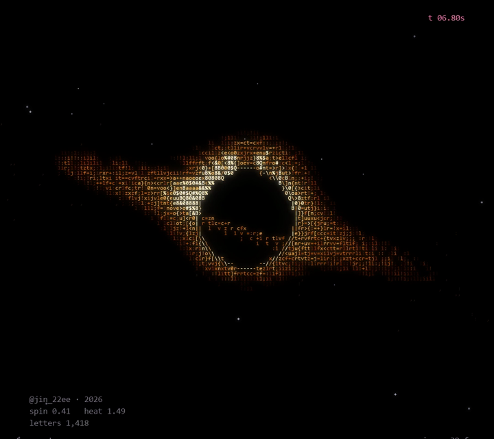
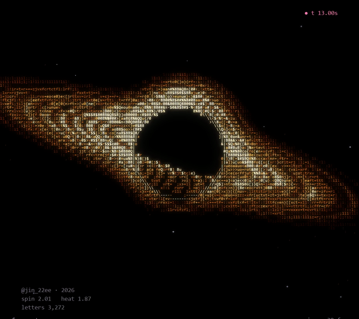

# BLACK HOLE

Black Hole · ASCII Code Art by JIN2, 2026



## Artist's Note

A thin circle of light draws itself, a red glow swells around it, and then the disk opens out to both sides.
At the flash the view moves in, and sparks of light ride the orbits, along the disk and up over the shadow.
Everything is drawn only with letters, numbers and symbols.

| the circle | the disk | the flow |
|---|---|---|
|  |  |  |

## Technology

Python · NumPy · pygame-ce

## Creative Process

1. Reference: real black hole images and simulations (NASA visualizations) for the shape: thin rings of gas, the bent far side, the brighter near side.
2. Shadow and ring: an empty centre with a thin ring of light around it.
3. Disk: a flat ring of gas seen almost edge on. Each cell becomes a radius and an angle on the disk, and inner orbits turn faster.
4. Bent light: the far side of the disk shows up as the ring around the shadow, with the same streaks as the disk so the two connect.
5. ASCII Rendering: hotter cells get denser letters and warmer colours. The ring is drawn with / | \ - along its direction.

## Technical Concepts

Per-cell field rendering (no meshes) · tilted disk coordinates · Keplerian rotation speed
Doppler brightening · screen blending between layers · comet-shaped light pulses · trail and glow pass

## Source Code

The full Python source is free and included in this folder.

```
pip install -r requirements.txt
python black_hole.py
```

Space pause, R restart, S screenshot, Esc quit.
Rules for using this code:
I share this code for you. Study it, change it, and use what you learn to make your own ASCII art.
- Don't repost this code, or a big part of it, as your own.
- Don't post my artwork (videos or images) as your own.
- Don't sell it, or use it commercially without my permission.
- Don't use it to train AI models.

A credit to @jin_22ee is always appreciated. If you see my code or artwork posted as someone else's, please report it and let me know on Instagram [@jin_22ee](https://instagram.com/jin_22ee).

Full terms: [LICENSE.txt](LICENSE.txt)

---

Artist: JIN2 · Instagram [@jin_22ee](https://instagram.com/jin_22ee)
© 2026 JIN2. All rights reserved. Images and video in this repository may not be reused without permission.
