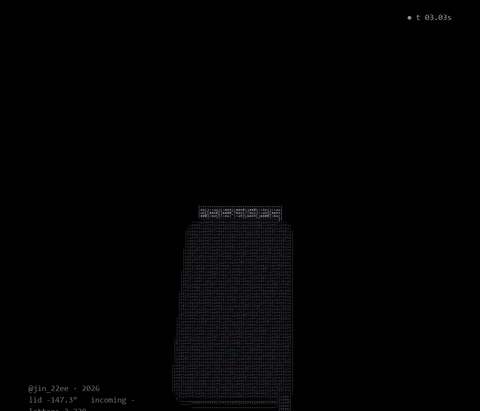
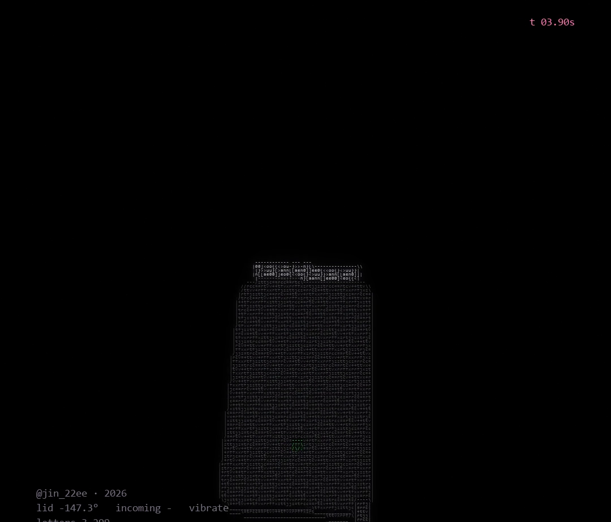
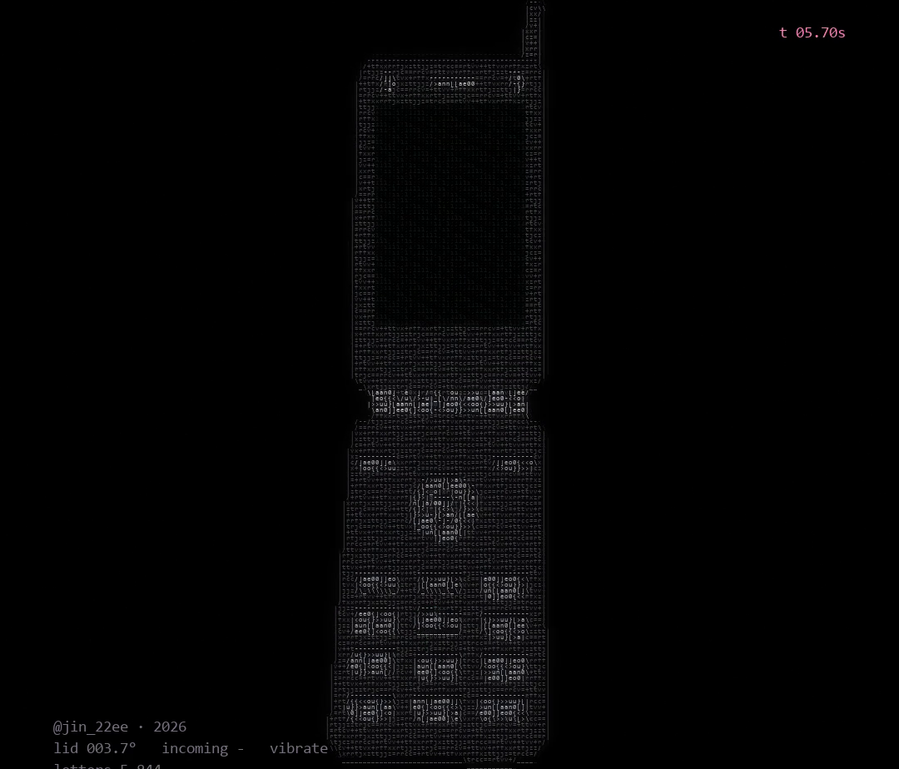
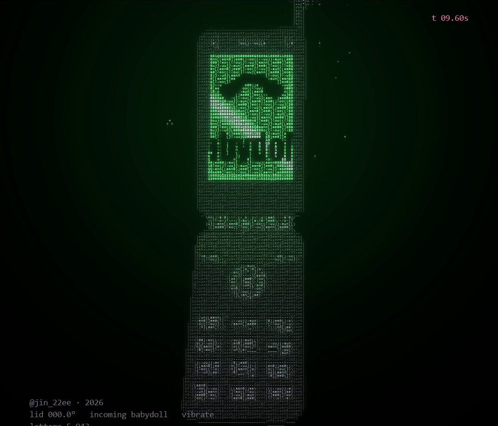

# FLIP PHONE

Incoming Call · ASCII Code Art · JIN2, 2026



## Artist's Note

An old flip phone, shut, buzzing on the table. It opens, the little screen lights up green, and "babydoll" is calling.

| shut | opening | calling |
|---|---|---|
|  |  |  |

## Technology

Python · NumPy · pygame-ce

## Creative Process

1. Phone: two halves joined at a hinge. The keypad half has twelve keys, two soft keys and a round d-pad; the screen half has the screen, a speaker and a short antenna.
2. Ring: it buzzes for 1.2 seconds and rests for 0.8, shaking a little while it is still shut.
3. Opening: the screen half swings up around the hinge, goes a little past and settles back.
4. Screen: it flickers on, turns green, and the handset and the scrolling name are cut out of the green, cell by cell.
5. Light: a band of light drifts across the glass, green light spills onto the keys near the hinge and glows around the screen, swelling with every buzz.

## Technical Concepts

Points on surfaces projected into a letter grid · outlines where one part ends · rotation about a hinge with an overshoot
Texture mapped onto the screen with a homography · light falloff by distance · trail and glow pass

## Source Code

The full Python source is free and included in this folder.

```
pip install -r requirements.txt
python flip_phone.py
```

Space pause, R restart, S screenshot, Esc quit.
Rules for using this code:
- Do not repost it, or a changed version of it, as your own.
- Do not post videos made from it as your own artwork.
- Do not sell it or use it commercially without written permission.
- Do not use it or its output to train AI.
- If you share something you made with it, credit @jin_22ee.
- If you see this code or the artwork posted as someone else's, please report it and let me know on Instagram [@jin_22ee](https://instagram.com/jin_22ee).

Full terms: [LICENSE.txt](LICENSE.txt)

---

Artist: JIN2 · Instagram [@jin_22ee](https://instagram.com/jin_22ee)
© 2026 JIN2. All rights reserved. Images and video in this repository may not be reused without permission.
