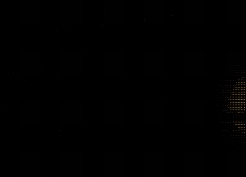
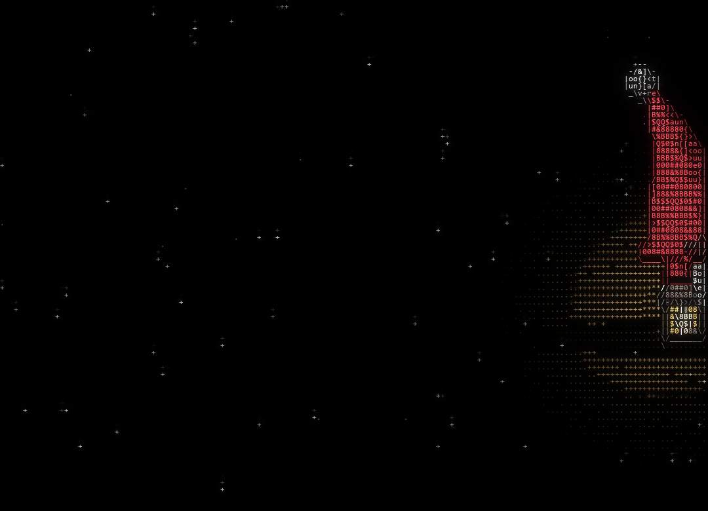
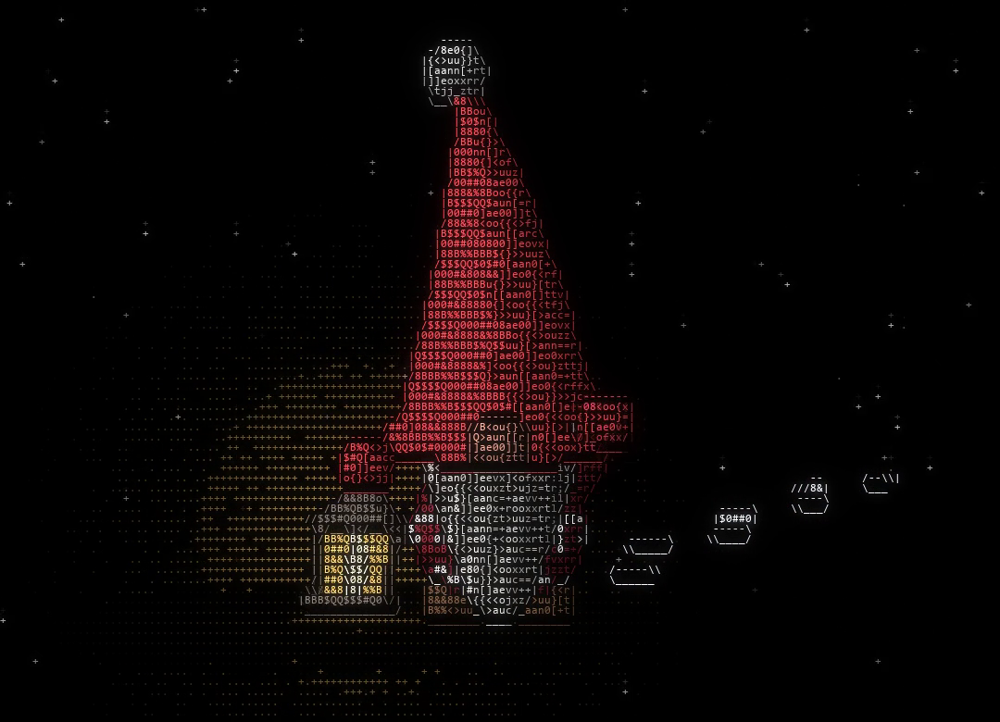
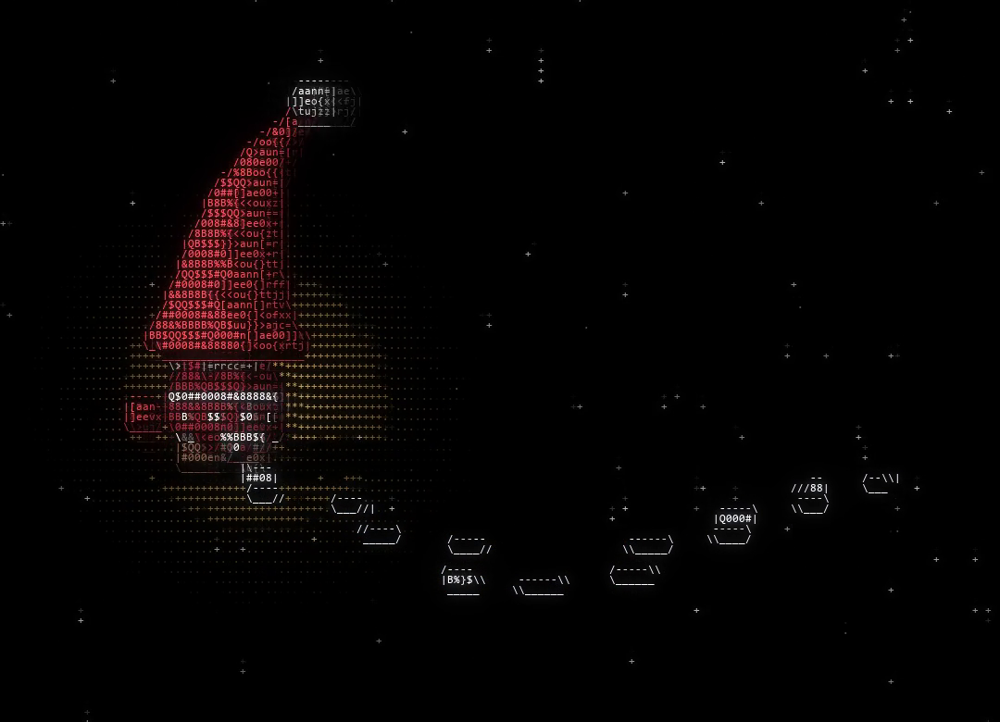

# GNOME

Christmas Gnome · ASCII Code Art · JIN2, 2026



## Artist's Note

A little gnome with a lantern peeks out from the edge of the screen, comes over to say hello, then turns round and walks off into the snow.
Only its footprints are left behind.
This is the first gnome. More are coming.

| peek | hello | walk |
|---|---|---|
|  |  |  |

## Technology

Python · NumPy · pygame-ce

## Creative Process

1. Figure: the coat, head, nose, mittens, boots and pompom are 3D egg shapes covered in points; the beard is a curved sheet and the hat is a cone around a bent spine.
2. Letters: every point is projected onto a letter grid, far to near, with denser letters where it is brighter and edge letters on the outline.
3. Lantern: a box with a roof and a candle, swinging from one hand, with a warm halo and a pool of light on the snow.
4. Motion: it slides out, slows before it stops, looks at you, walks closer, waves, turns round and walks away.
5. Snow: falling snow and a white footprint for every step.

## Technical Concepts

3D point surfaces with normals · rotation about the vertical axis · perspective projection with depth ordering
Outline detection between parts · easing with slow stops · footprints placed on each step · trail and glow pass

## Source Code

The full Python source is free and included in this folder.

```
pip install -r requirements.txt
python gnome.py
```

Space pause, R restart, S screenshot, Esc quit.
Rules for using this code:
I share this code for you. Study it, change it, and use what you learn to make your own ASCII art.
- Don't repost this code, or a big part of it, as your own.
- Don't post my artwork (videos or images) as your own.
- Don't sell it, or use it commercially without my permission.
- Don't use it with AI.

A credit to @jin_22ee is always appreciated. If you see my code or artwork posted as someone else's, please report it and let me know on Instagram [@jin_22ee](https://instagram.com/jin_22ee).

Full terms: [LICENSE.txt](LICENSE.txt)

---

Artist: JIN2 · Instagram [@jin_22ee](https://instagram.com/jin_22ee)
© 2026 JIN2. All rights reserved. Images and video in this repository may not be reused without permission.
