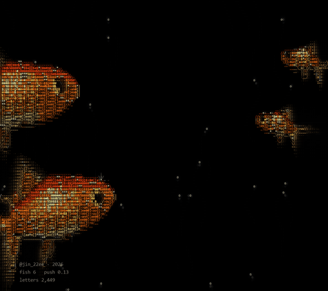
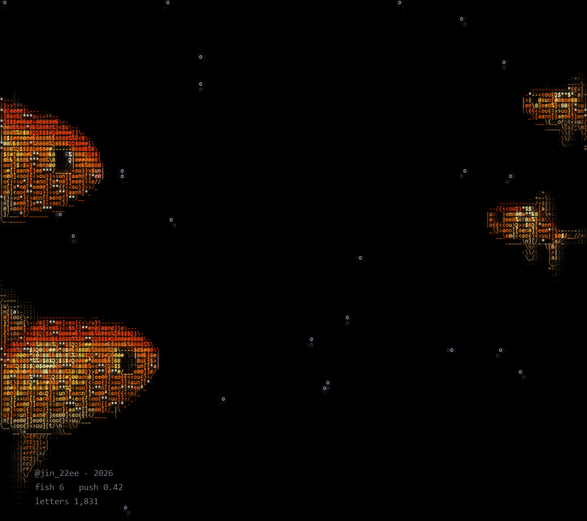
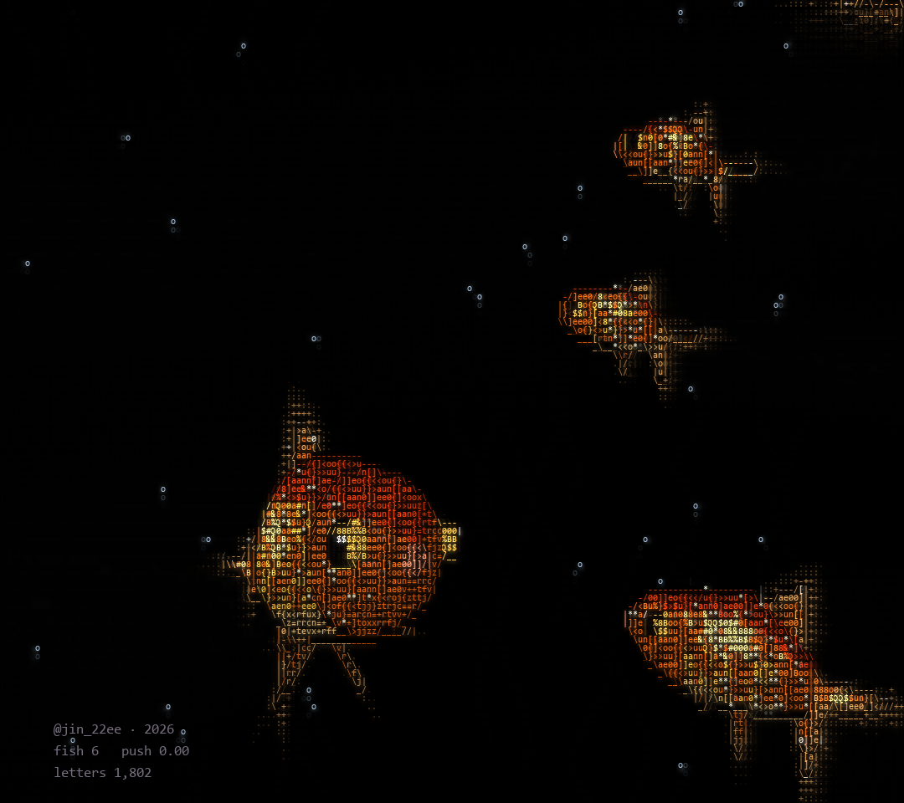
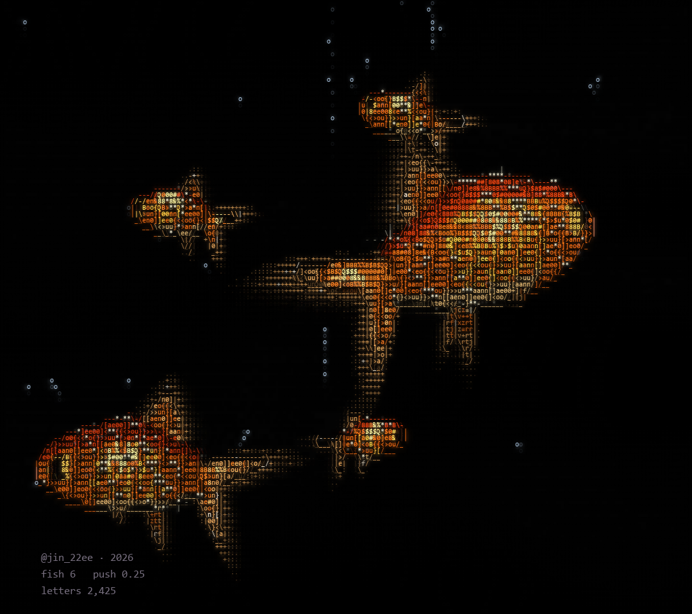

# GOLDFISH

Goldfish · ASCII Code Art · JIN2, 2026



## Artist's Note

Six goldfish swim through dark water.
Some glide, some dart and pause, the small ones drift far behind.
One of them stops for a moment to look at you, then swims on.

| swim | hello | together |
|---|---|---|
|  |  |  |

## Technology

Python · NumPy · pygame-ce

## Creative Process

1. Shape: the side outline of a goldfish, swept round into a real 3D body with a raised gill cover, bulging eyes and a mouth that opens and closes.
2. Skin: offset rows of scales, red on the back, gold on the flank, pale on the belly.
3. Fins: two-lobed tail and soft fins with rays, solid near the body and thinning out to nothing at the edge.
4. Light: from the upper left; the side facing it is brighter, scale edges catch highlights and a scale flashes now and then.
5. Motion: six paths, near and far, each with its own pace, turns and pauses, and bubbles rising.

## Technical Concepts

Surface of revolution from a 2D outline · surface normals and specular light · keyframed paths with smooth curves
Heading from velocity · perspective projection with depth ordering · outline detection between parts · trail and glow pass

## Source Code

The full Python source is included in this folder.

```
pip install -r requirements.txt
python goldfish.py
```

Space pause, R restart, S screenshot, Esc quit.
Rules for using this code:
I share this code for you. Study it, change it, and use what you learn to make your own ASCII art.
- Don't repost this code, or a big part of it, as your own.
- Don't post my artwork (videos or images) as your own.
- Don't sell it, or use it commercially without my permission.
- Don't use it with AI.

A credit to @jin_22ee is always appreciated. If you see my code or artwork posted as someone else's, please report it and let me know on Instagram [@jin_22ee](https://instagram.com/jin_22ee).

Full terms: [LICENSE.txt](LICENSE.txt)

---

Artist: JIN2 · Instagram [@jin_22ee](https://instagram.com/jin_22ee)
© 2026 JIN2. All rights reserved. Images and video in this repository may not be reused without permission.
