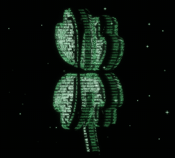
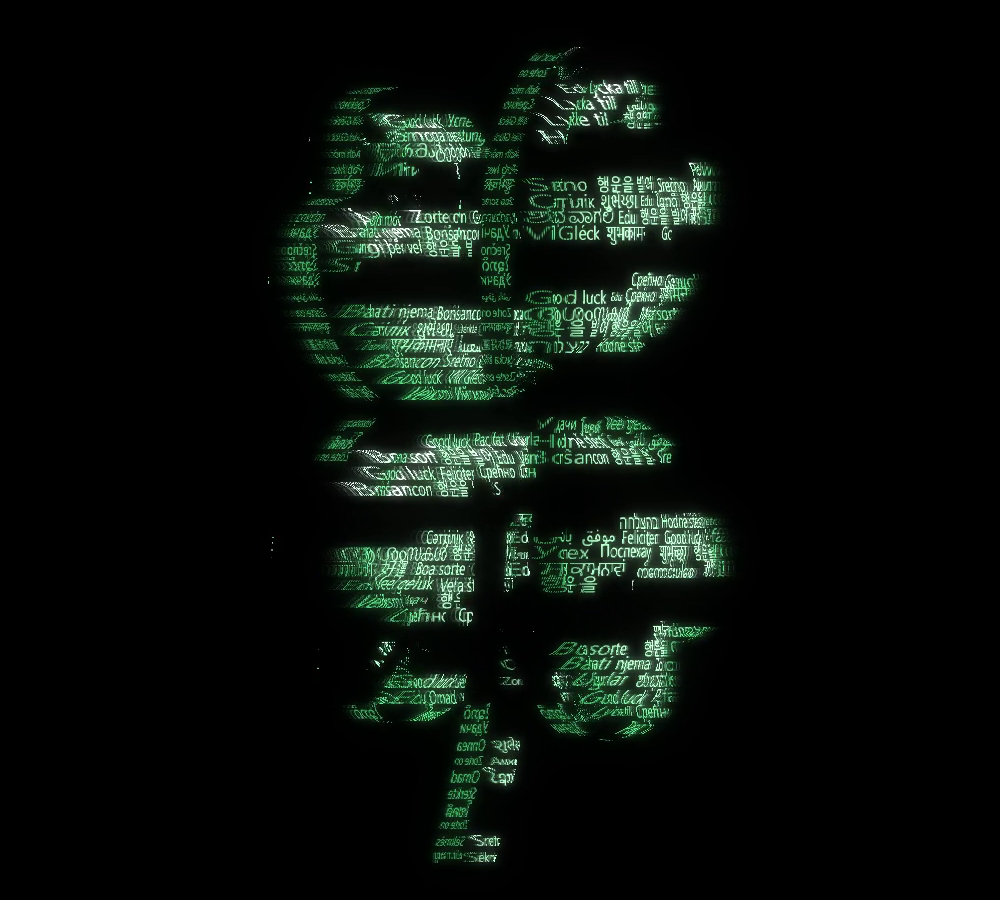
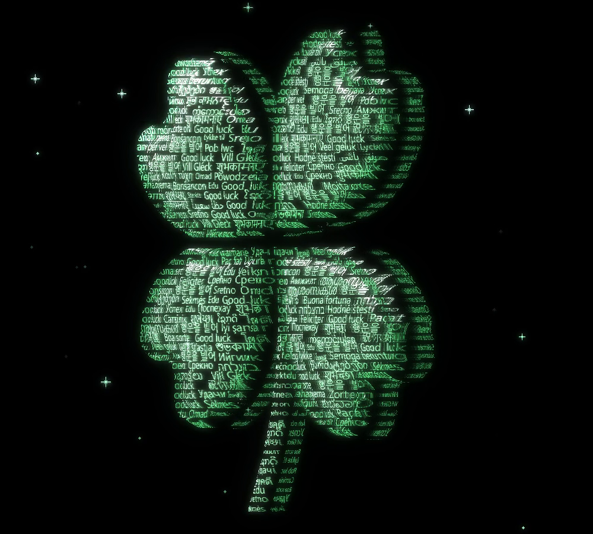
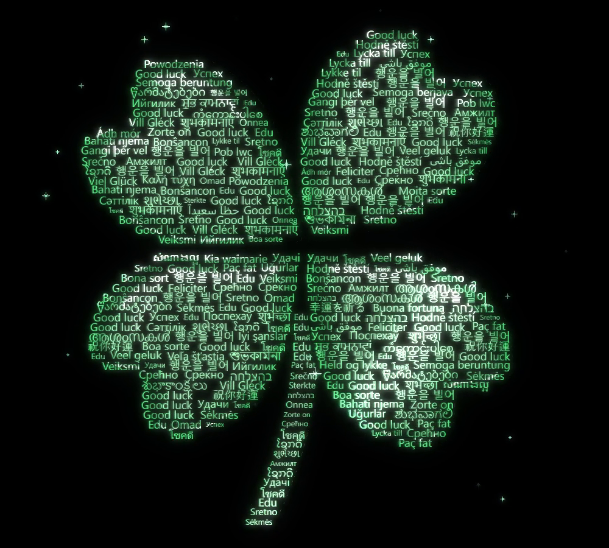

# GOOD LUCK

Four-Leaf Clover · ASCII Code Art · JIN2, 2026



## Artist's Note

Last time I made a heart that says "I love you" in every language, and it gave me the idea for this four-leaf clover.
"Good luck" in 77 languages, written row by row, and the letters alone make the clover.
I hope good luck finds every one of you.

| typing | turning | front |
|---|---|---|
|  |  |  |

## Technology

Python · NumPy · OpenCV · pygame-ce

## Creative Process

1. Phrases: "Good luck" in 77 languages, each drawn once so every script is shaped correctly.
2. Shape: each leaf is one heart, four of them point out from the middle, and a curved stem runs down.
3. Rows: each row of every leaf is filled edge to edge with whole phrases, like justified text.
4. Depth: every leaf has flat sides, a bulging face and a raised rim; the stem is a thinner rod.
5. Glass and light: the clover turns to the right, pale green in the middle and deep green at the edge, with a band of light and small green stars.

## Technical Concepts

Justified text layout · distance transform for depth · rotation about the vertical axis with depth ordering
Green glass shading by edge thickness and reflection · light sweep and sparkles · trail and glow pass

## Source Code

The full Python source is free and included in this folder.

```
pip install -r requirements.txt
python good_luck.py
```

Space pause, R restart, S screenshot, Esc quit.
Free for personal projects. Please credit @jin_22ee if you share what you make. See LICENSE.txt.

---

Artist: JIN2 · Instagram [@jin_22ee](https://instagram.com/jin_22ee)
© 2026 JIN2. All rights reserved. Images and video in this repository may not be reused without permission.
