# JIN2 · ASCII Code Art

JIN2 is a creative coding artist who writes artworks in Python.
Every piece is drawn only with letters, numbers and symbols.

This repository is an archive of the works and a technical portfolio:
what each piece is, why it was made, and which techniques shaped it.

## Works

| | Work | Year | Source code |
|---|---|---|---|
| 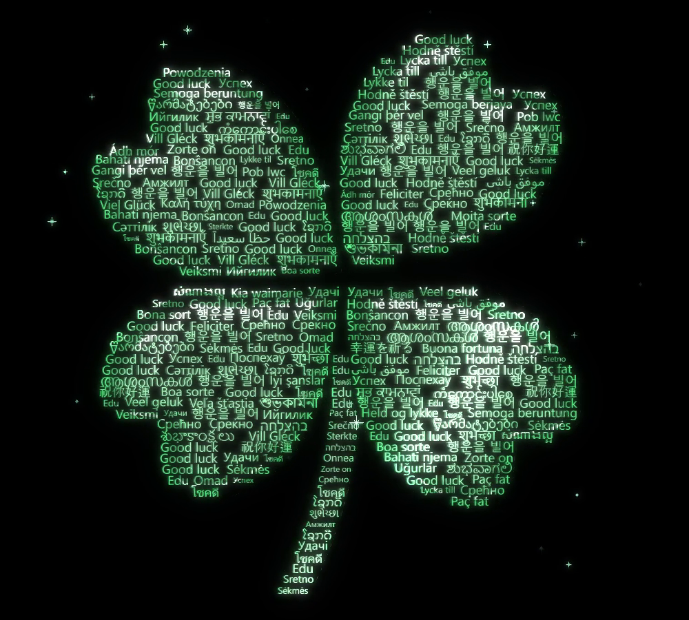 | [GOOD LUCK (Four-Leaf Clover)](GOOD-LUCK/) | 2026 | free, in this repository |
| 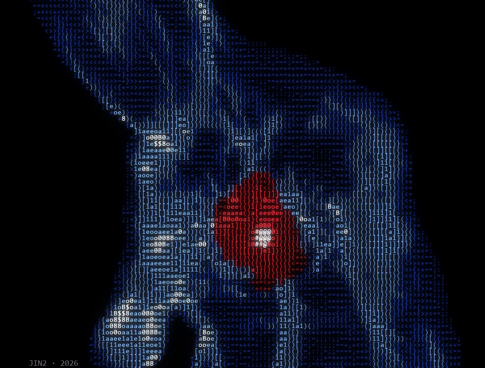 | [SKIPPED A BEAT](SKIPPED-A-BEAT/) | 2026 | full code, in this repository |
| 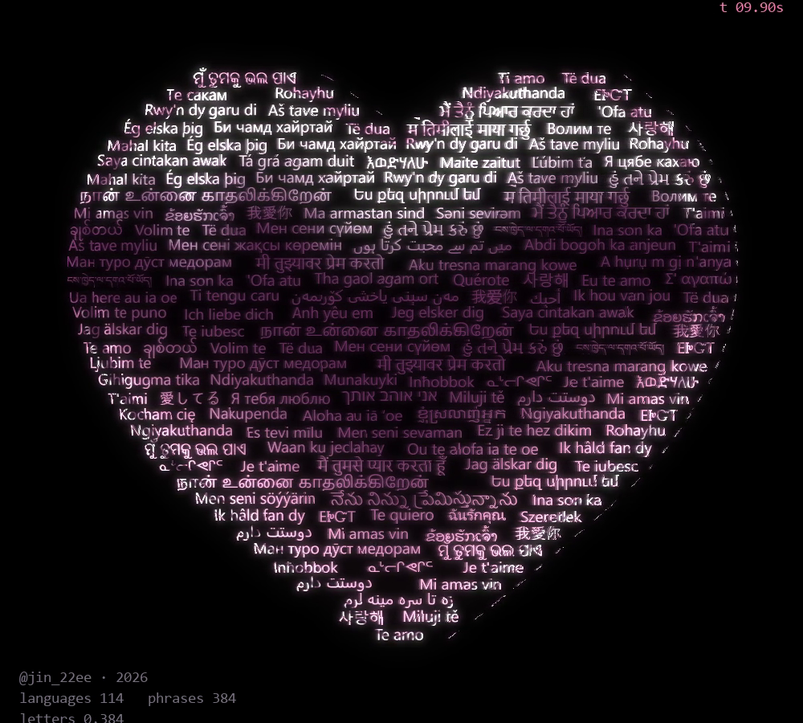 | [I LOVE YOU](I-LOVE-YOU/) | 2026 | free, in this repository |
| 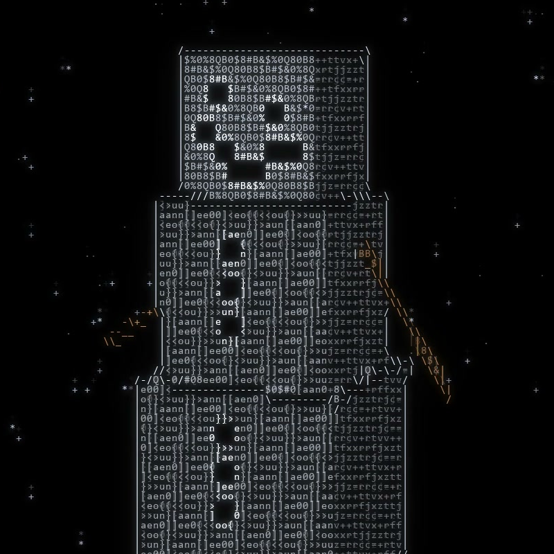 | [DON'T MELT (Snowman)](SNOWMAN/) | 2026 | free, in this repository |
| 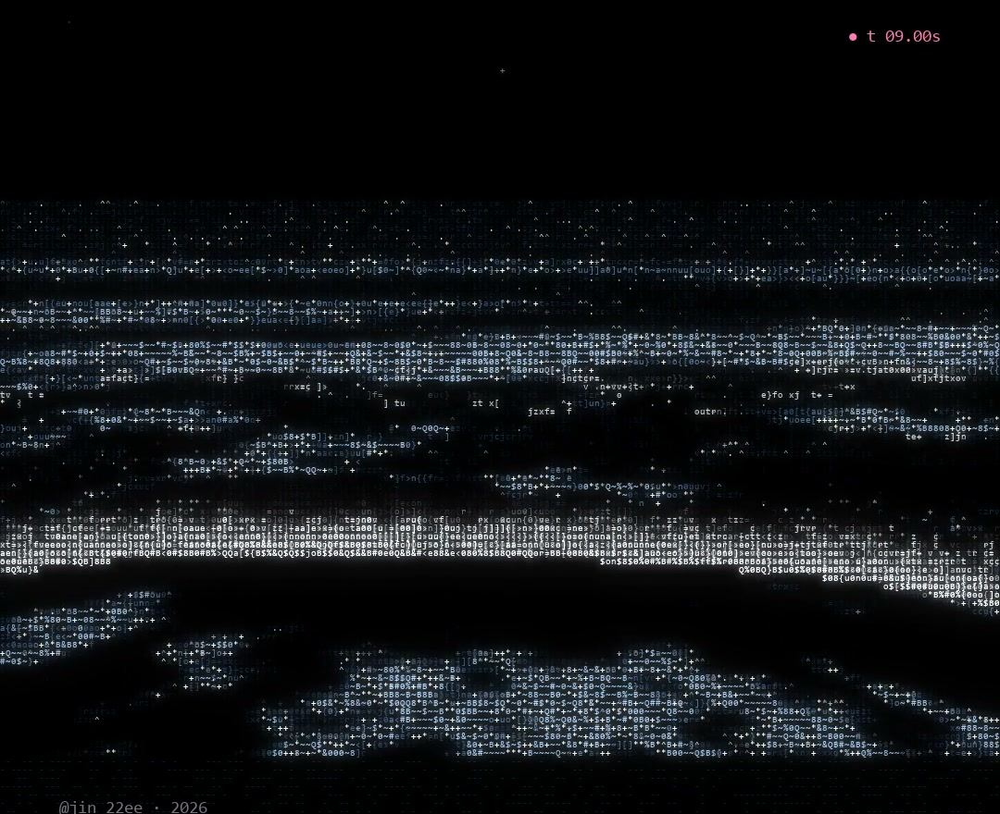 | [NIGHT TIDE](NIGHT-TIDE/) | 2026 | free, in this repository |
| 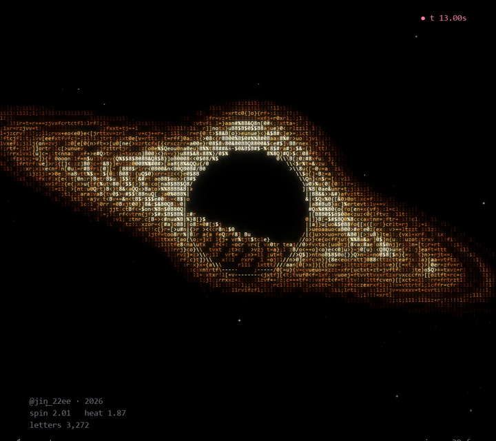 | [BLACK HOLE](BLACK-HOLE/) | 2026 | free, in this repository |
| 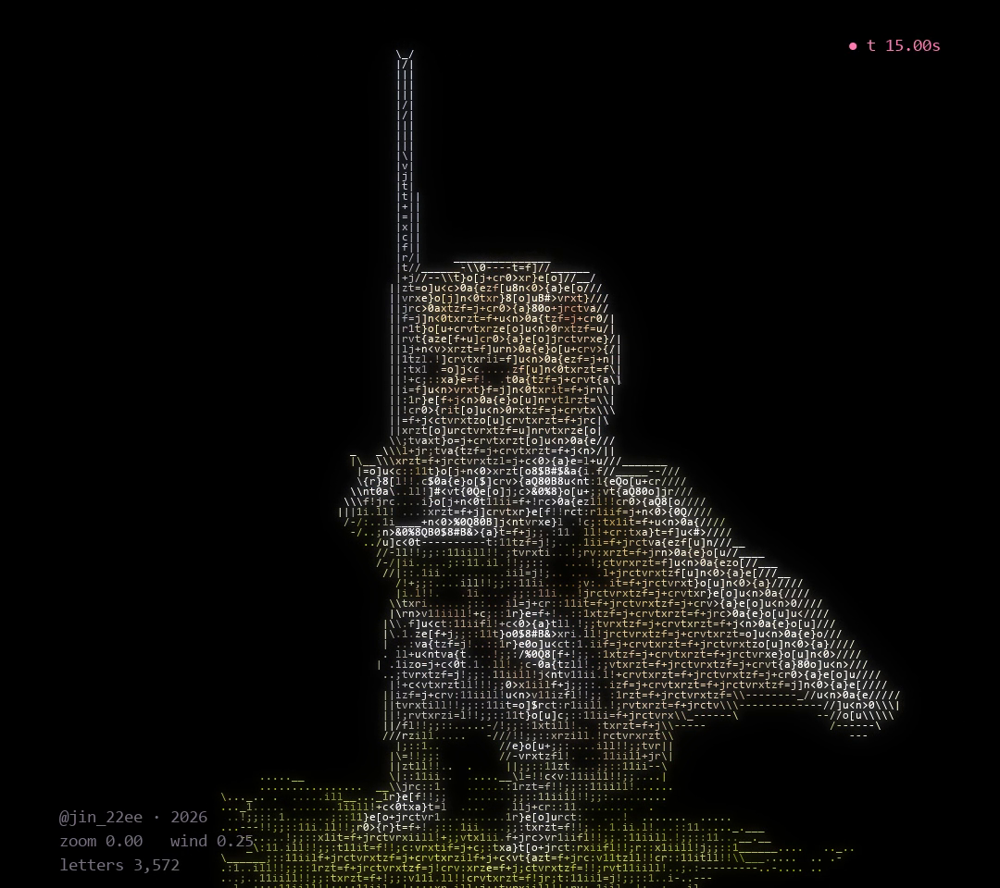 | [CAT KNIGHT](CAT-KNIGHT/) | 2026 | full code, in this repository |
| 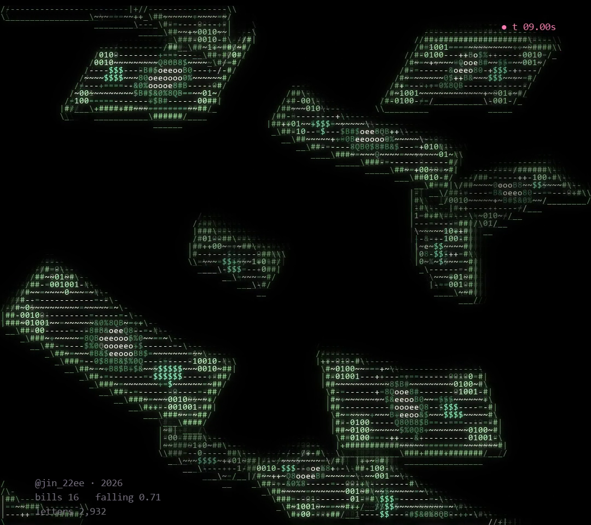 | [MONEY RAIN](MONEY-RAIN/) | 2026 | free, in this repository |
| 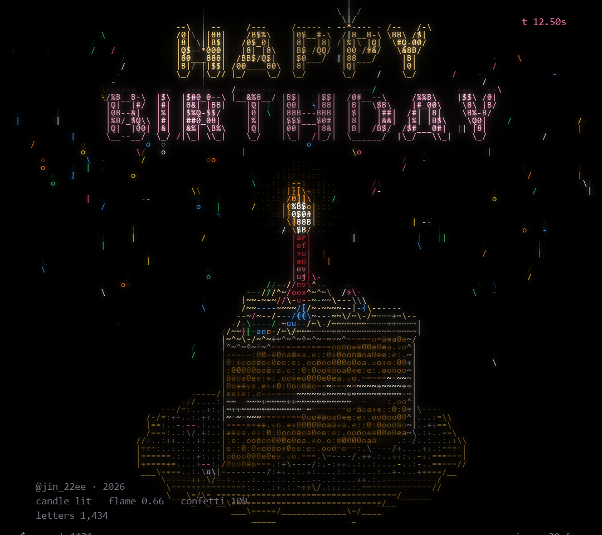 | [HAPPY BIRTHDAY (Birthday Cake)](BIRTHDAY-CAKE/) | 2026 | free, in this repository |
| 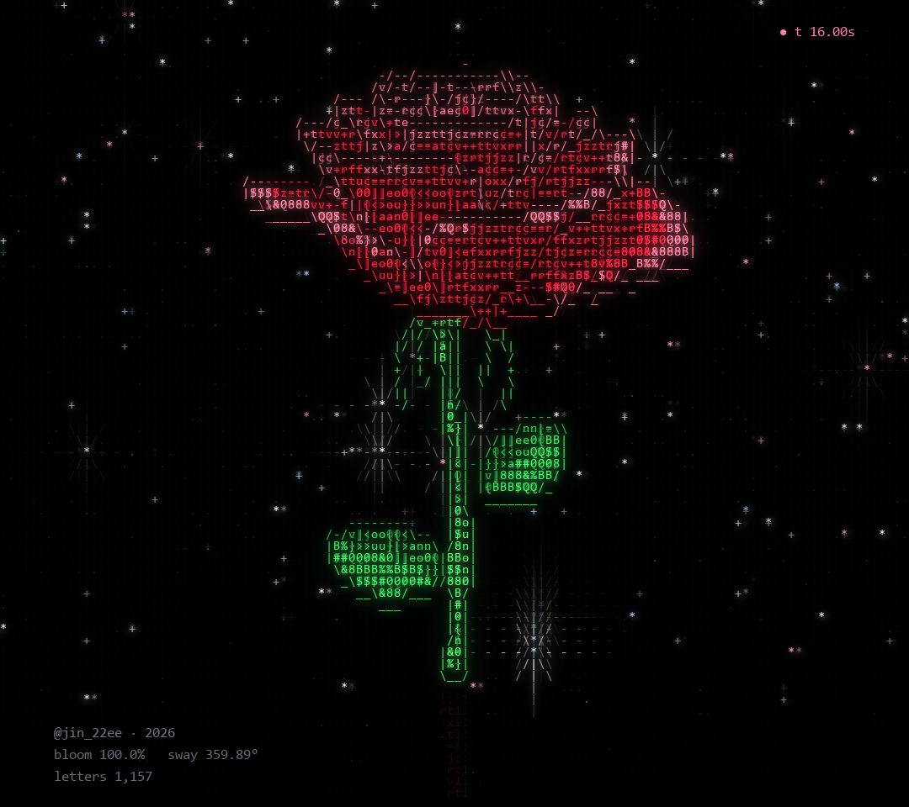 | [IN BLOOM (Rose)](ROSE/) | 2026 | free, in this repository |
| 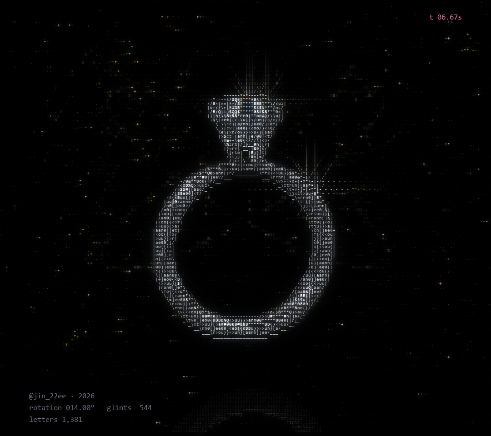 | [WILL YOU (Diamond Ring)](DIAMOND-RING/) | 2026 | free, in this repository |

New works are added over time.

## Technology

Python · NumPy · pygame-ce · Pillow · OpenCV. No 3D software.

## Links

- Instagram: [@jin_22ee](https://instagram.com/jin_22ee)
- Code shop: [payhip.com/JIN2](https://payhip.com/JIN2)

---

© 2026 JIN2. All rights reserved.
Images and videos in this repository may not be reused without permission.
