# JIN2 · ASCII Code Art

JIN2 is a creative coding artist who writes artworks in Python.
Every piece is drawn only with letters, numbers and symbols.

This repository is an archive of the works and a technical portfolio:
what each piece is, why it was made, and which techniques shaped it.

## Works

| | Work | Year | Source code |
|---|---|---|---|
| 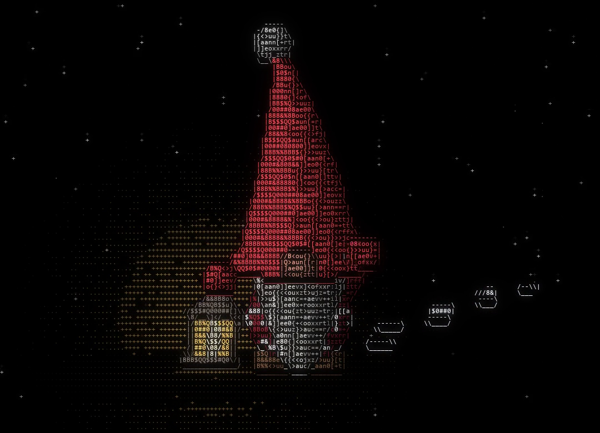 | [GNOME](GNOME/) | 2026 | free, in this repository |
| 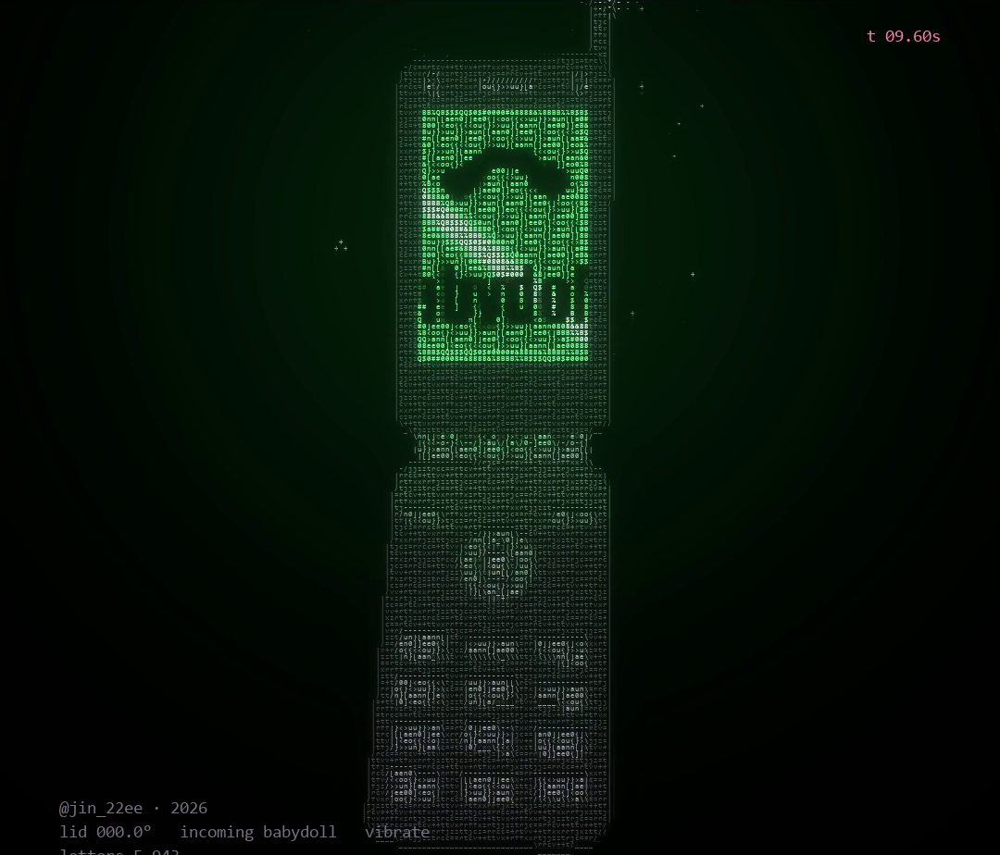 | [FLIP PHONE (Incoming Call)](FLIP-PHONE/) | 2026 | full code, in this repository |
| 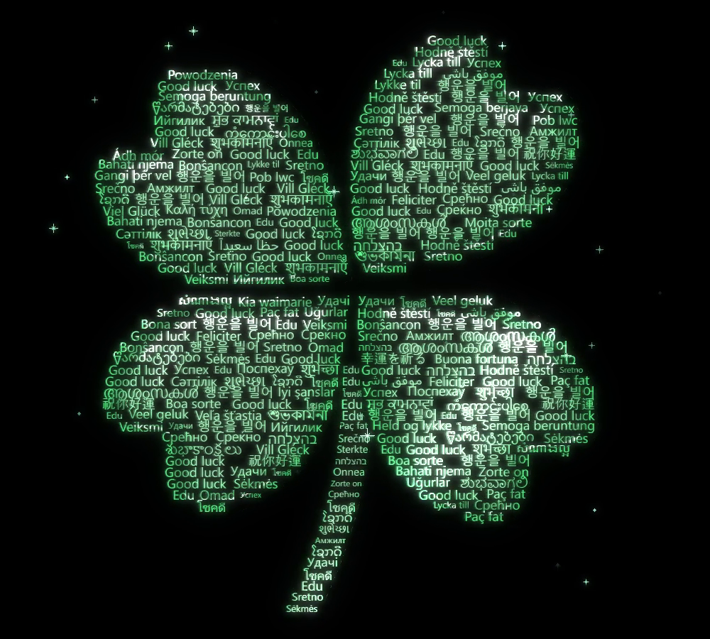 | [GOOD LUCK (Four-Leaf Clover)](GOOD-LUCK/) | 2026 | free, in this repository |
| 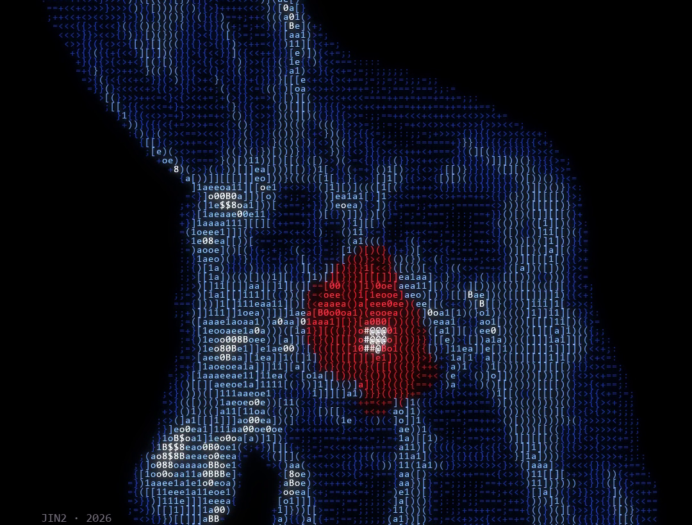 | [SKIPPED A BEAT](SKIPPED-A-BEAT/) | 2026 | full code, in this repository |
| 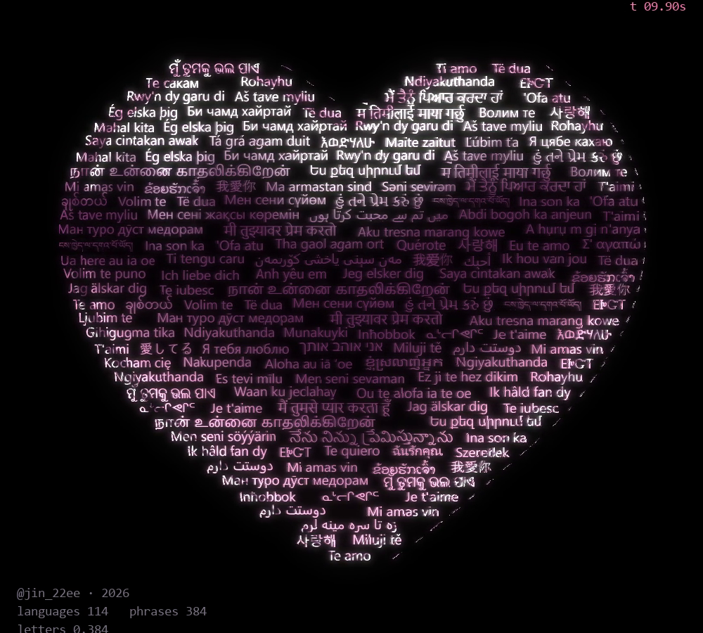 | [I LOVE YOU](I-LOVE-YOU/) | 2026 | free, in this repository |
| 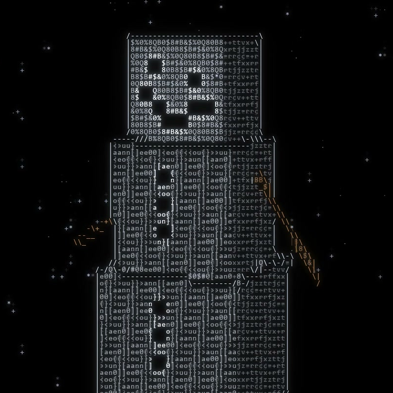 | [DON'T MELT (Snowman)](SNOWMAN/) | 2026 | free, in this repository |
| 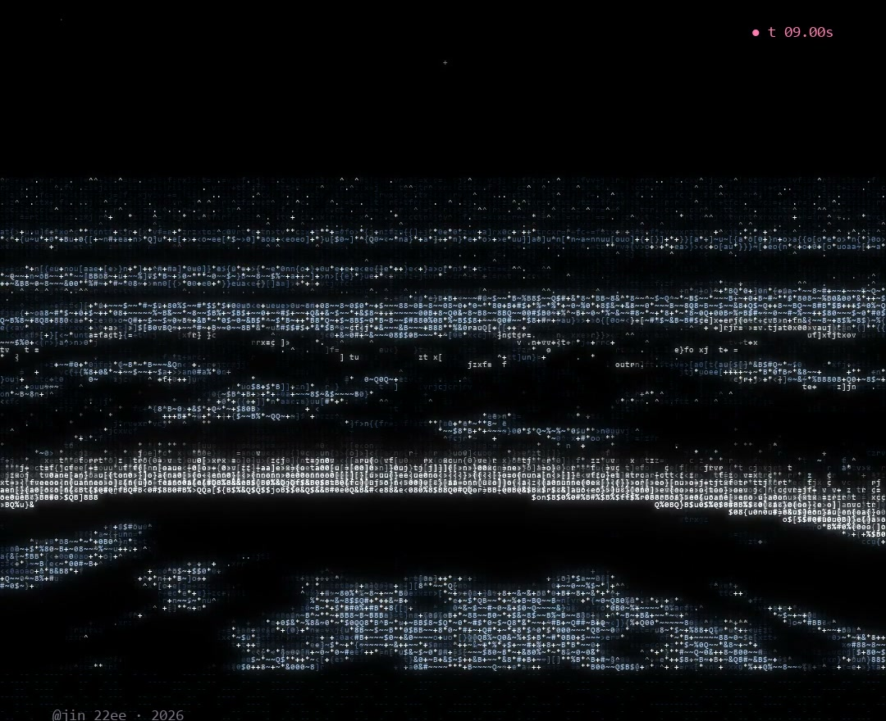 | [NIGHT TIDE](NIGHT-TIDE/) | 2026 | free, in this repository |
| 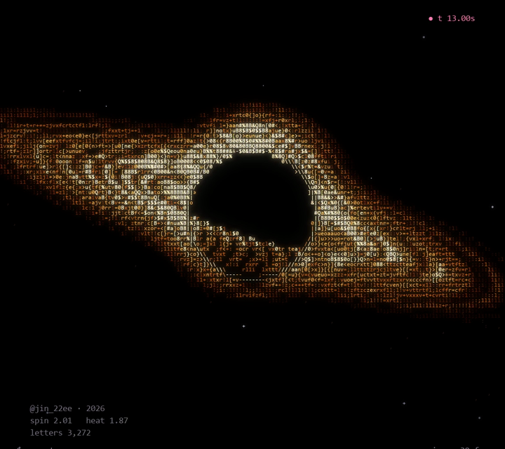 | [BLACK HOLE](BLACK-HOLE/) | 2026 | free, in this repository |
| 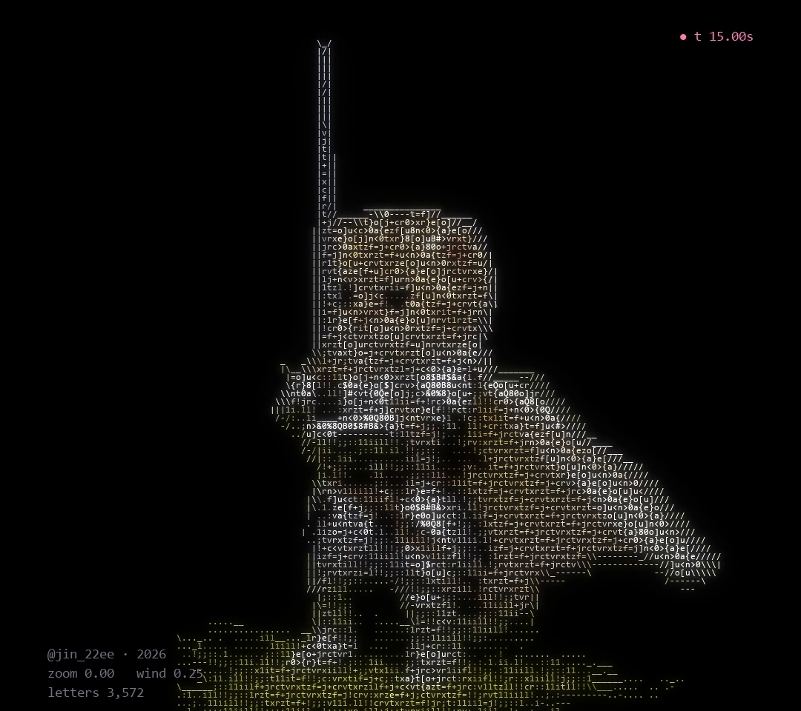 | [CAT KNIGHT](CAT-KNIGHT/) | 2026 | full code, in this repository |
| 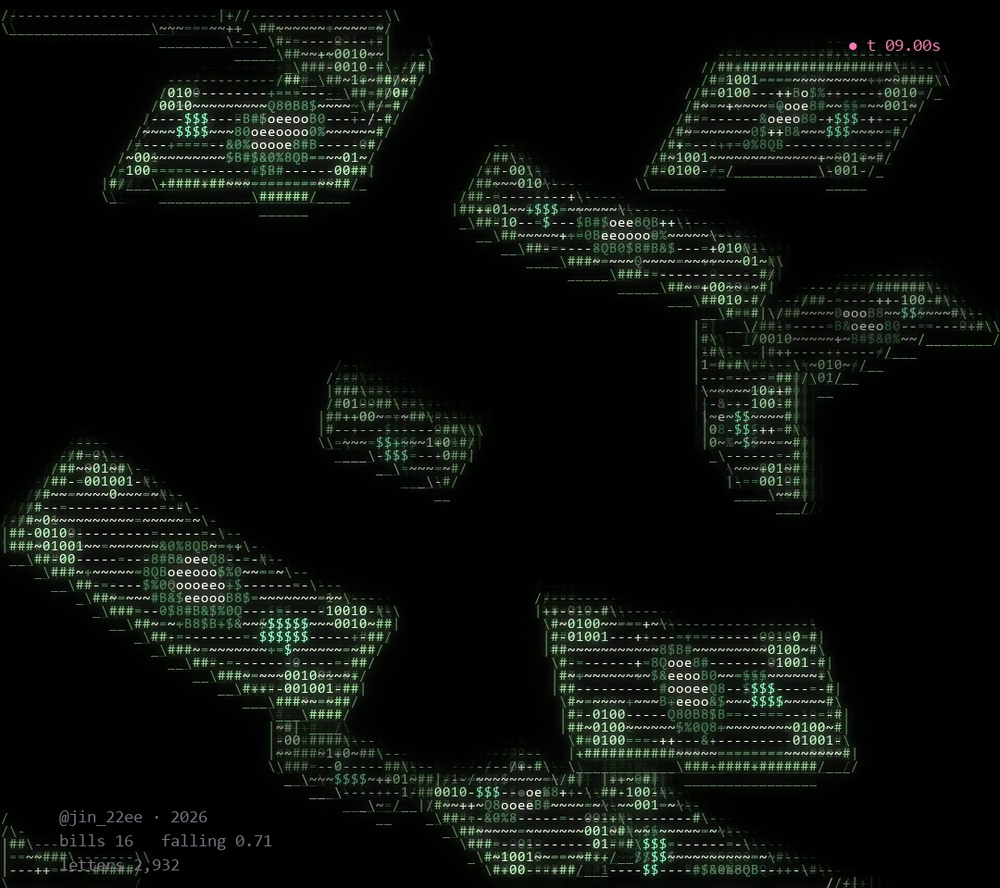 | [MONEY RAIN](MONEY-RAIN/) | 2026 | free, in this repository |
| 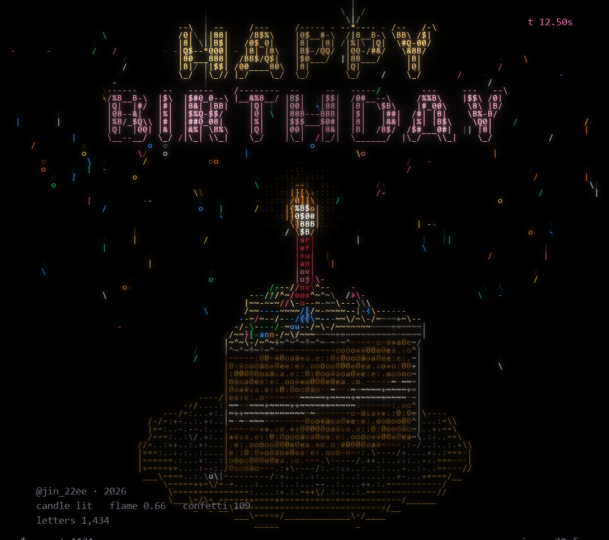 | [HAPPY BIRTHDAY (Birthday Cake)](BIRTHDAY-CAKE/) | 2026 | free, in this repository |
| 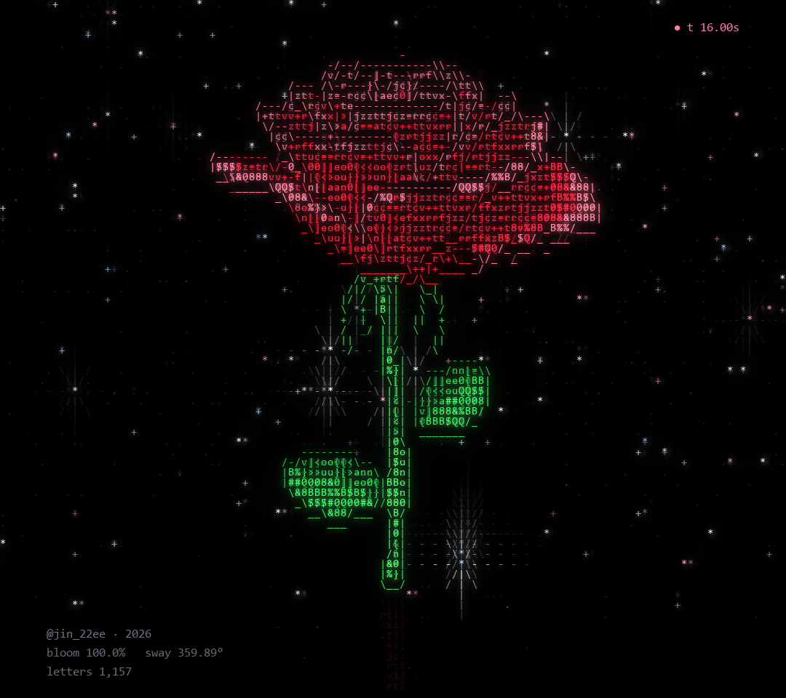 | [IN BLOOM (Rose)](ROSE/) | 2026 | free, in this repository |
| 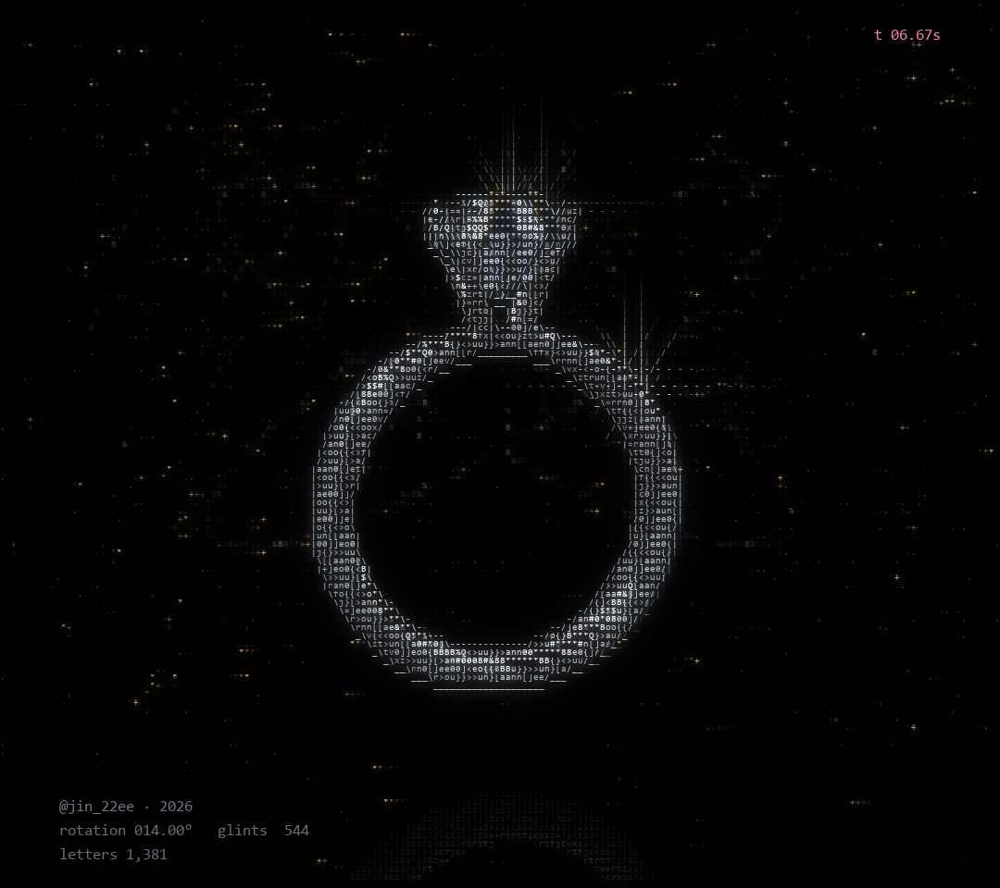 | [WILL YOU (Diamond Ring)](DIAMOND-RING/) | 2026 | free, in this repository |

New works are added over time.

## Technology

Python · NumPy · pygame-ce · Pillow · OpenCV. No 3D software.

## Links

- Instagram: [@jin_22ee](https://instagram.com/jin_22ee)
- Code shop: [payhip.com/JIN2](https://payhip.com/JIN2)

---

## License

Free for personal use: run it, study it, change it for your own projects.
Not allowed: redistributing or repackaging it (repos, packages, templates, "skills", tools, datasets),
reposting it or a changed version of it as your own, posting videos made from it as your own artwork,
any commercial use, AI training or dataset use, or presenting the work, its techniques,
character sets or visual style as your own. If you post anything made with it, you must credit "@jin_22ee" in the caption or description.
If you see my code or artwork posted as someone else's, please report it and let me know on Instagram [@jin_22ee](https://instagram.com/jin_22ee).
Full terms in [LICENSE.txt](LICENSE.txt).
Permission exists only if JIN2 gave it to you in writing.

© 2026 JIN2. All rights reserved.
Images and videos in this repository may not be reused without permission.
