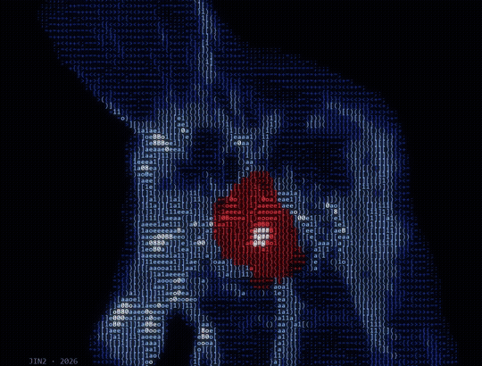
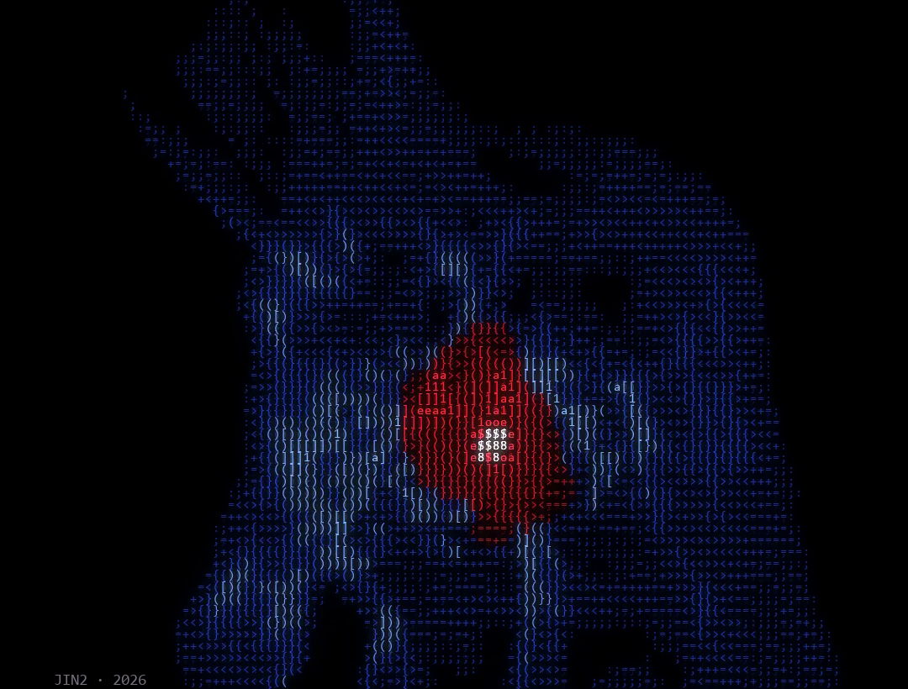
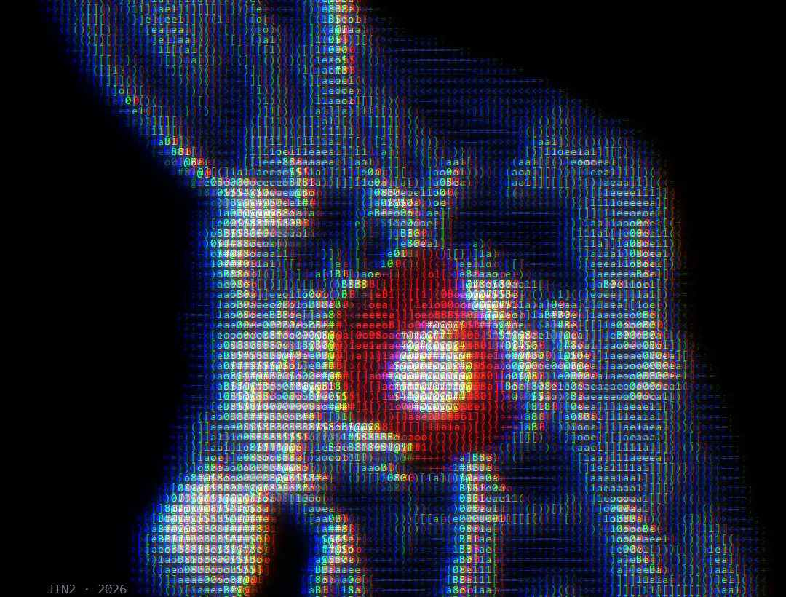
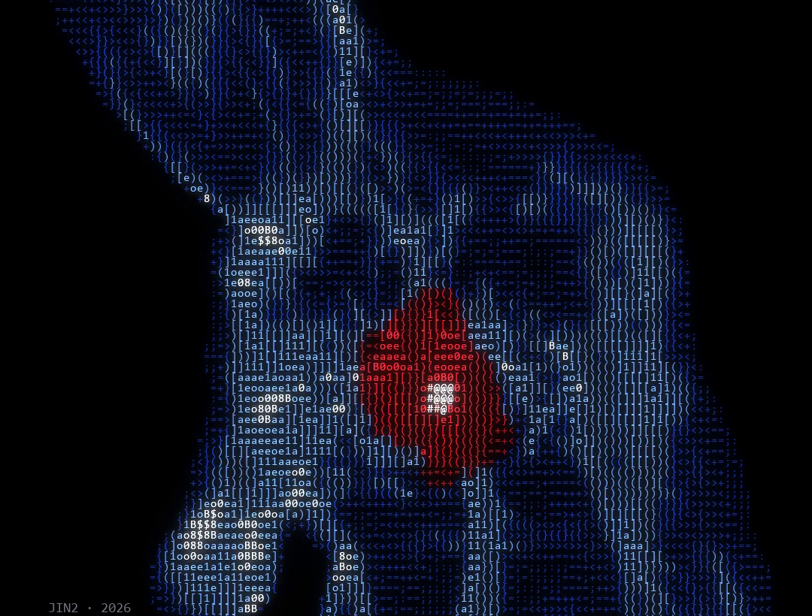

# SKIPPED A BEAT

Startled Heart · ASCII Code Art by JIN2, 2026



## Artist's Note

Horror game streamer clips keep showing up in my Reels, and people always drop this picture in the comments.
The meme was so funny and relatable that I made my own version, drawn only in letters and numbers.
Every 1.6 seconds the whole body flinches, the heart swells out of the chest and a shock wave runs down the veins.

| arriving | flinch | heart |
|---|---|---|
|  |  |  |

## About the Picture

The x-ray body picture is not mine, so this piece is not for sale and the picture is not included.
The finished letters of all 480 frames are in skipped_a_beat_frames.npz, and the full code to play them is shared here.
All credit for the picture goes to its creator.

## Technology

Python · NumPy · pygame-ce (the frames were made with OpenCV)

## Creative Process

1. Layers: the picture is split into the blue body and the red heart.
2. Flinch: every 1.6 seconds the body jumps by 6 percent and shivers back, with a smaller second beat after it.
3. Heart: the area around the heart is pushed outwards, so it swells out of the chest, and a white spark flares up.
4. Shock wave: a ring of light runs out from the heart along the veins.
5. ASCII Rendering: each frame becomes a grid of 120 x 68 letters; brightness picks the letter and the colour marks body, heart and spark.

## Technical Concepts

Image warping with remap · damped spring curve for the flinch · radial bulge around a point
Letter grid by brightness · colour split on impact · trail and glow pass

## Source Code

The full Python source is included in this folder.

```
pip install -r requirements.txt
python skipped_a_beat.py
```

Space pause, R restart, S screenshot, Esc quit.
For personal projects. Please credit @jin_22ee if you share what you make. See LICENSE.txt.

---

Artist: JIN2 · Instagram [@jin_22ee](https://instagram.com/jin_22ee)
Code © 2026 JIN2. The x-ray body picture belongs to its creator.
