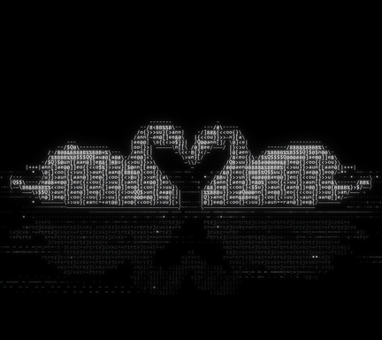
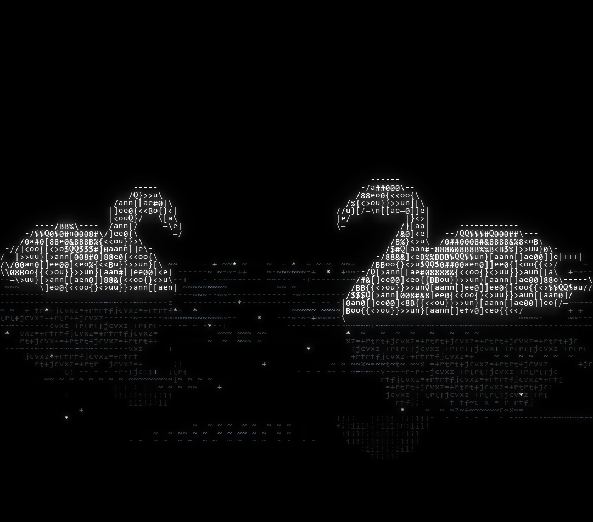
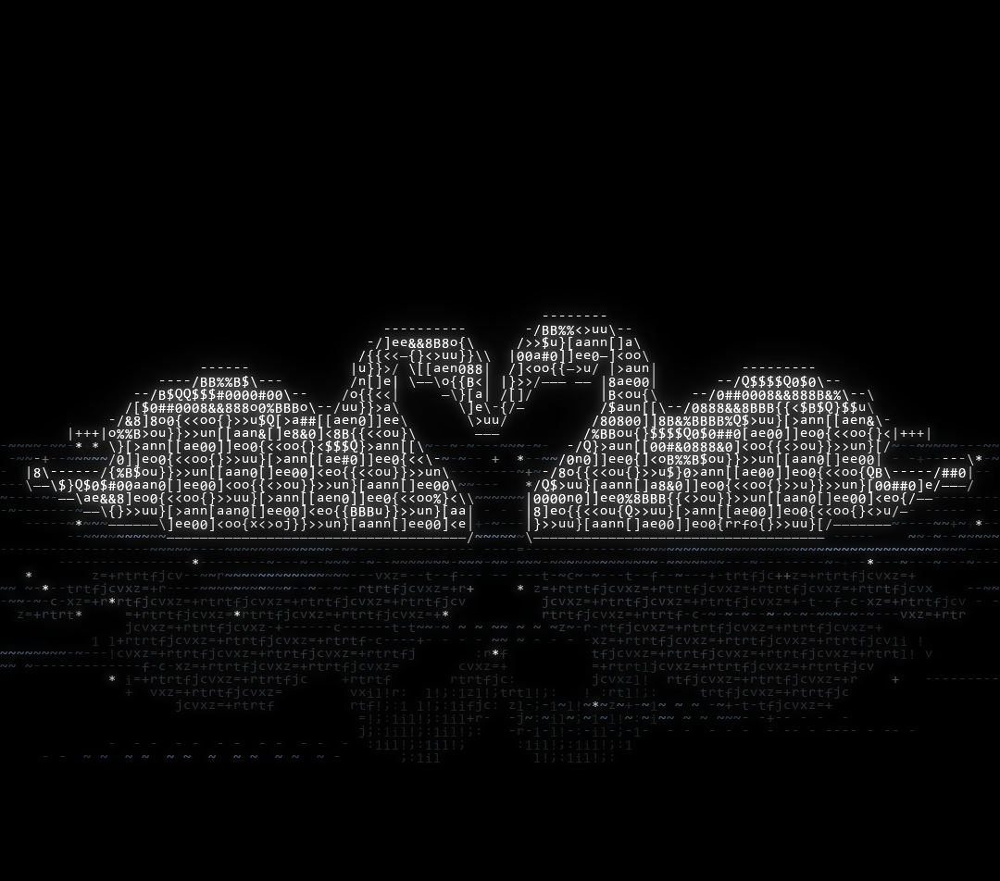
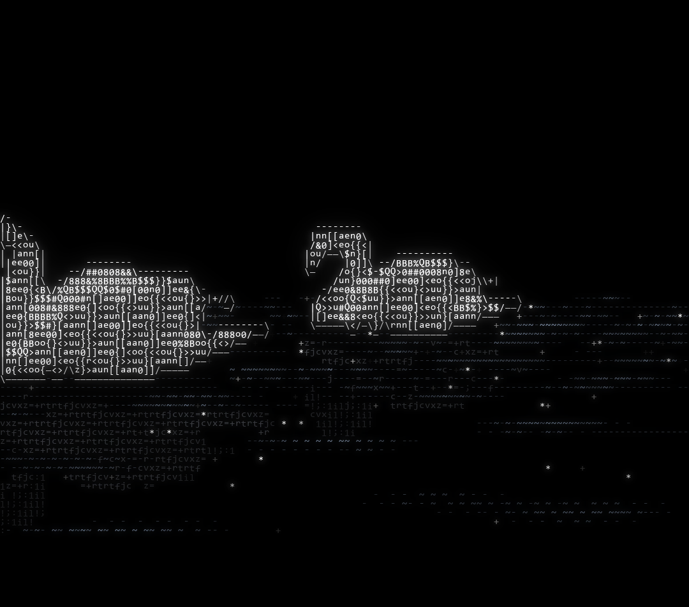

# SWAN

Swan · ASCII Code Art · JIN2, 2026



## Artist's Note

One swan comes in from the right. Another, far back on the left, swims closer.
They meet, lower their heads until the beaks touch, and their two necks make a heart.
Then the second one slips behind the first, turns far back, and follows it out of frame.

| arrive | heart | follow |
|---|---|---|
|  |  |  |

## Technology

Python · NumPy · SciPy · pygame-ce

## Creative Process

1. Shape: a side view traced as an outline, puffed into a rounded body from the distance to the edge, with a mirrored far side so it reads as a solid when it turns.
2. Neck: a centre line split into bones; every neck point remembers its bone and follows it as the bones rotate, while the head stays one rigid piece.
3. Motion: each swan follows a path of waypoints with a smooth curve between them, and its heading comes from the direction of travel.
4. Water: overlapping ripple waves, a brighter patch and a V wake around each swan, rings pushed out by the breast, and one ring where the beaks meet.
5. Letters: points projected onto a grid of letters, brighter cells with denser letters, the outline in / | \ - _ and the water in ~ - _.

## Technical Concepts

Point cloud with surface normals · bone-based deformation with weight blending · monotone cubic path interpolation
Perspective projection with depth ordering · planar reflection with displacement · per-cell hashing for texture · trail and glow pass

## Source Code

The full Python source is included in this folder (swan.py and swan_shape.npz belong together).

```
pip install -r requirements.txt
python swan.py
```

Space pause, R restart, S screenshot, Esc quit.
Rules for using this code:
I share this code for you. Study it, change it, and use what you learn to make your own ASCII art.
- Don't repost this code, or a big part of it, as your own.
- Don't post my artwork (videos or images) as your own.
- Don't sell it, or use it commercially without my permission.
- Don't use it to train AI models.

A credit to @jin_22ee is always appreciated. If you see my code or artwork posted as someone else's, please report it and let me know on Instagram [@jin_22ee](https://instagram.com/jin_22ee).

Full terms: [LICENSE.txt](LICENSE.txt)

---

Artist: JIN2 · Instagram [@jin_22ee](https://instagram.com/jin_22ee)
© 2026 JIN2. All rights reserved. Images and video in this repository may not be reused without permission.
