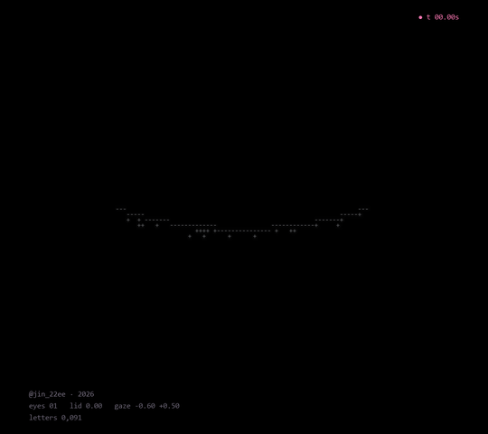
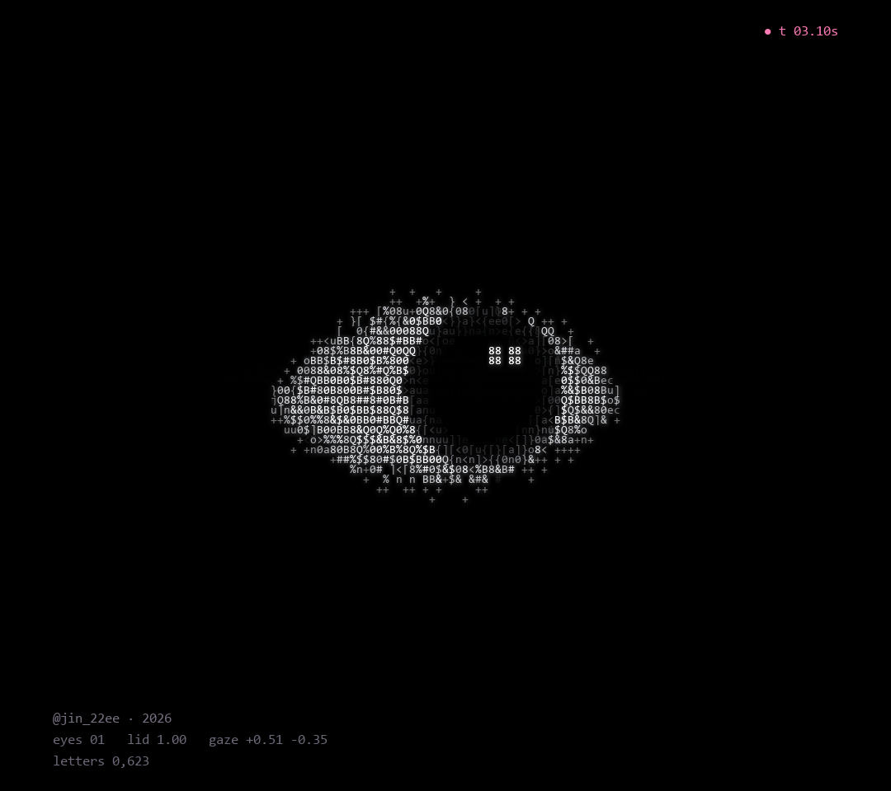
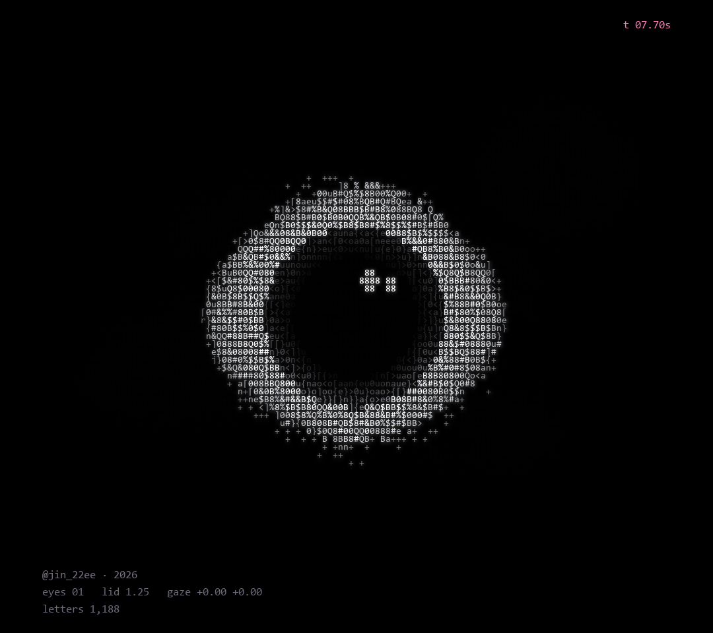
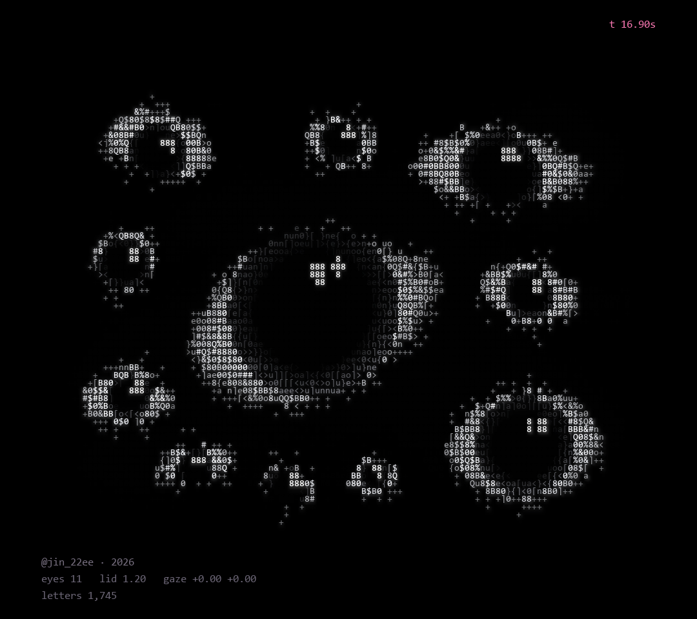

# WATCHING

Eyes in the Dark · ASCII Code Art · JIN2, 2026



## Artist's Note

An eye in the dark. It is shut, then it opens at once and looks around, fast, blinking.
Every cut is a different eye, and each one looks at something else.
At the end there are too many of them, and they all find you.

| opens | stare | found you |
|---|---|---|
|  |  |  |

## Technology

Python · NumPy · pygame-ce

## Creative Process

1. Eye: an almond cut out of the letter grid, with its own corner sharpness, lid curve and slant, so every eye has a different face.
2. Letters: grey-white letters for the eyeball, a black iris with a grey rim, two highlights, and + signs for the lashes.
3. Motion: it opens in one snap, the pupil jumps from spot to spot, and the eye blinks in quarter steps.
4. Cuts: short shots that overlap in time, each placed where it touches no other eye and far from the last one.
5. Ending: many eyes of different sizes look around, then all of them look at you and grow.

## Technical Concepts

Superellipse lid masks with separate corner exponents · rotation and shear per eye · grain from a fixed noise field
Keyframed pupil, lid and scale · overlap checks between ellipses · seeded random streams · row-shift glitch

## Source Code

The full Python source is free and included in this folder.

```
pip install -r requirements.txt
python watching.py
```

Space pause, R restart, S screenshot, Esc quit.
Rules for using this code:
I share this code for you. Study it, change it, and use what you learn to make your own ASCII art.
- Don't repost this code, or a big part of it, as your own.
- Don't post my artwork (videos or images) as your own.
- Don't sell it, or use it commercially without my permission.
- Don't use it to train AI models.

A credit to @jin_22ee is always appreciated. If you see my code or artwork posted as someone else's, please report it and let me know on Instagram [@jin_22ee](https://instagram.com/jin_22ee).

Full terms: [LICENSE.txt](LICENSE.txt)

---

Artist: JIN2 · Instagram [@jin_22ee](https://instagram.com/jin_22ee)
© 2026 JIN2. All rights reserved. Images and video in this repository may not be reused without permission.
